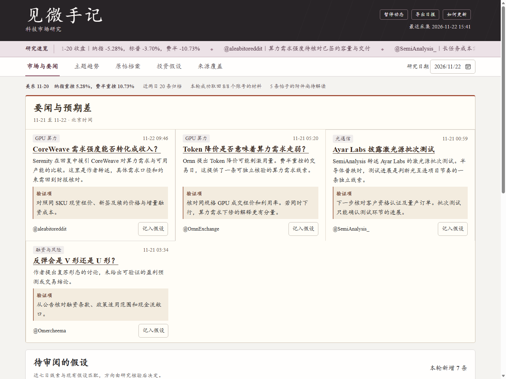

# 见微手记

面向买方投研的 X 信息看板。按主题整理八个账号的帖子，结合美股行情查看市场变化，并将值得跟踪的线索挂到投资假设上。

**[直接打开在线投研看板](https://zane-pku.github.io/x-equity-research-dashboard/)**

在线版可直接浏览、筛选和导出日报。也可下载项目，用浏览器打开根目录的 [index.html](./index.html)。

## 界面预览

[](https://zane-pku.github.io/x-equity-research-dashboard/)

[主题趋势](./docs/screenshots/themes.png) · [来源覆盖](./docs/screenshots/sources.png)

## 项目文件

| 文件 | 用途 |
| --- | --- |
| [index.html](./index.html) | 单文件看板及内置归档 |
| [update_market.py](./update_market.py) | 手动同步，把更新写回同目录的看板 |

## 本地更新

需要 Python 3.10+ 和系统 `curl`。在项目目录打开 PowerShell：

```powershell
py -B .\update_market.py
```

更新完成后刷新浏览器。脚本把行情和新帖写回同目录的 `index.html`。用 `--date YYYY-MM-DD` 可以指定北京时间的研究日期。

| 参数 | 用途 |
| --- | --- |
| `--check` | 离线检查项目入口、归档结构和重复帖子编号。本机有 Node.js 时也检查 JavaScript 语法 |
| `--images` | 扩大图片 OCR 扫描范围，依赖 Windows 的 OCR 组件 |
| `--x-api` | 用本机环境变量 `X_BEARER_TOKEN` 核对官方时间线，可能产生 API 费用 |
| `--research` | 用本机环境变量 `OPENAI_API_KEY` 生成待人工复核的研究草稿 |

## 看板内容

- **市场与要闻**汇总近期线索、收盘表现和待审阅的假设。顶部「研究速览」可以暂停。
- **主题趋势**按时间加权展示归档分布，可切换研究窗口和半衰期。
- **原帖档案**支持按账号、主题、日期和关键词筛选。
- **投资假设**记录验证项、证伪条件、证据和判断变更。个人修改保存在当前浏览器，页面支持 JSON 备份和恢复。项目内的 HTML 包含内置假设和公开归档。
- **来源覆盖**展示各账号的最新已归档时间和采集情况。公开索引可能滞后，研究线索需回原帖和一手资料核验。

监控账号为 `@aleabitoreddit`、`@SemiAnalysis_`、`@Omercheema`、`@OrnnExchange`、`@HedgeyeTech`、`@RYANHINGSHING`、`@FredaDuan`、`@TMTLongShort`。


## 迁移个人研究记录

从旧的看板进入「投资假设」，点击「导出假设备份」。在此项目的看板中点击「导入假设备份」，选中导出的 JSON。导入会合并记录，同编号保留更新时间较新的一份。个人备份请保存在项目目录之外。
